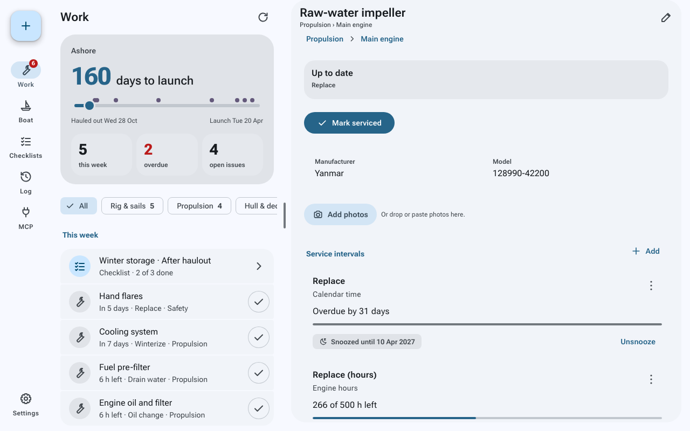

# Maintenance Tracker MCP for Signal K

A maintenance plan that lives on your boat. Record every system and part aboard, from
the engine down to the impeller, and it tells you what's due, before launch and after
haulout. Keep it up to date by telling your AI assistant what you did.

*Great minds think alike! This plugin is not related to
[hoeken's signalk-maintenance-tracker](https://github.com/hoeken/signalk-maintenance-tracker),
which is also worth a look.*



## Why use it

- **Your whole boat in one place.** Record each system, its components and parts, with
  maker, model and serial number, so you can look up which filter fits or what the
  impeller's part number is. Start from a typical boat or build your own.
- **Log work by talking.** A built-in [MCP](https://modelcontextprotocol.io/) server
  lets Claude, ChatGPT and other assistants read and update the plan. Say *"Changed the
  impeller"* and the job is logged and its interval restarts. Ask *"What's left before
  launch?"* and get the answer.
- **Intervals that match how boats wear.** Every 200 engine hours or once a year,
  whichever comes first. Two weeks before launch. The expiry date printed on the
  flares. Engine hours come straight from Signal K.
- **Planned around your season.** The Work list counts down to launch or haulout and
  shows what's due this week, what's overdue and what must be done before the boat
  goes in.
- **Runs on the boat.** It's a Signal K plugin with its own web app for phone, tablet
  and laptop. It works on the boat's network without internet; only the AI connection
  needs one.
- **Your records, in plain files.** Every change is a git commit on the server, with
  optional backup to a private repository. Nothing is locked in a cloud account.

It also keeps a list of issues (a loose tiller, a weeping seacock) with a fix-by
milestone, runs checklists for launch and haulout, stores photos of nameplates and
damage, and raises Signal K notifications when jobs come due.

## Get started

You need Signal K server 2.x on Node.js 22 or later, and git on the server (Raspberry
Pi OS has it).

1. In the Signal K Admin UI, open **Appstore → Available**, install **Maintenance
   Tracker MCP** and restart the server.
2. Enable it under **Server → Plugin Config → Maintenance Tracker MCP**.
3. Open it from **Webapps**, or at `http://<your-server>:3000/signalk-maintenance-tracker-mcp/`.
4. Choose **Start with a typical boat**. You get a sailing boat with an inboard engine,
   laid out with common intervals: engine, fuel, rig, hull, safety, gas and more.
   Delete what you don't have and set each part's last service.
5. Add your launch and haulout dates under **Boat → Seasons**. Season jobs count from
   them.
6. For hours-based jobs, check that *Engine-hours Signal K path* in Plugin Config
   points at your engine's running time. The default, `propulsion.main.runTime`, is where
   [signalk-engine-hours](https://www.npmjs.com/package/signalk-engine-hours) writes.

To install from a git checkout, for example on a Raspberry Pi, see [DEPLOY.md](DEPLOY.md).

## Connect an AI assistant

Assistants run in the cloud, so the MCP server needs a public HTTPS address: a
[Cloudflare Tunnel](https://developers.cloudflare.com/cloudflare-one/connections/connect-networks/),
Tailscale Funnel or a reverse proxy pointed at port `8766`.

The web app's **MCP** page does the rest. It creates the access key, saves your public
address, shows the connector address to add in your assistant, and tells you when the
first request arrives.

| Your assistant | Connector URL | Authentication |
|---|---|---|
| Can send a header (Claude Code, most MCP clients) | `https://<your-host>/mcp` | `Authorization: Bearer <key>` |
| Takes only an address (claude.ai custom connectors) | `https://<your-host>/mcp/<secret>` | The secret in the address |

Then talk to it:

- *"What's due in the next month?"*
- *"Changed the engine oil and filter at 1234 hours. It cost 60 euros."*
- *"The tiller is loose on the rudder shaft. Fix it before launch."*
- *"Start the haulout checklist."*

For better results, add the ready-made [skill](skill/SKILL.md), which the MCP page
offers as a ZIP for Claude and as text for other assistants. In Claude, the assistant
can also open a photo panel to attach pictures to a record.

## How jobs come due

A part can have several triggers. The one closest to due sets its status.

| Trigger | Example |
|---|---|
| Calendar | Service the winches every 2 years |
| Engine hours | Change the oil every 200 hours |
| Trips | Check the bilge pump every 10 trips |
| Season | Antifouling 3 weeks before launch, winterize 2 weeks after haulout |
| Expiry | Replace the flares on the date printed on them |

A job is *due soon* inside its warning time (14 days, 10 hours or 1 trip by default, 30
days before an expiry) and *overdue* after. Logging it restarts the count.

For each job the plugin publishes `notifications.maintenance.<part>.<trigger>`: `warn`
when due soon and `alarm` when overdue, so any Signal K app can show it.

## Your data

Records are YAML files in `~/.signalk/plugin-config-data/signalk-maintenance-tracker-mcp/`,
a git repository with one commit per change. To keep a copy off the boat, set
*Git-backed storage → Remote URL* to a private repository and turn on *Push to remote*. The server needs
credentials for it, such as an SSH deploy key.

The REST API is under `/plugins/signalk-maintenance-tracker-mcp/`, described in
[`schema/openapi.yaml`](schema/openapi.yaml) and in the Admin UI under
**Documentation → OpenAPI**.

## Security

- The web app and REST API use your Signal K login. Read-only accounts can look;
  read-write accounts can change the plan.
- The MCP server has its own key and doesn't start without one. It refuses any
  request without the key, and it can reach only the maintenance records.
- Expose it only over HTTPS, and set *Allowed hosts* to your public host name to turn
  on DNS-rebinding protection.

## Development

```bash
npm install
npm run build     # plugin and web app
npm test
npm run dev:web   # web app with hot reload at http://localhost:3778, plugin included
```

`SK_URL=http://localhost:3778 node tools/dev-fixtures.mjs` fills the dev server with a
sample boat. The web app is in `web/` (Preact, TypeScript, Vite).

Parts of this plugin were written with AI assistance. Reviewed and tested before
release; [issues and PRs](https://github.com/fymmot/signalk-maintenance-tracker-mcp/issues)
welcome.

## Licence

[MIT](LICENSE). The web app bundles Material Symbols (© Google, Apache 2.0) and
Roboto Flex (© The Roboto Flex Project Authors, SIL OFL 1.1).
